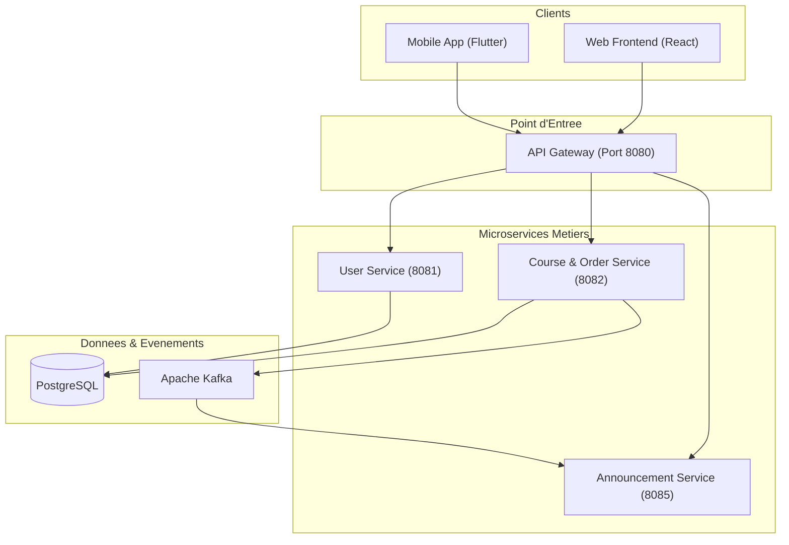

# C4 Niveau 2 : Diagramme des Conteneurs

Le diagramme ci-dessous présente la vue simplifiée des conteneurs applicatifs de la plateforme **EduMarket** et leurs flux d'échange essentiels.

## Architecture des Conteneurs

## Description des Conteneurs Principaux

- **Clients (Web / Mobile)** : Interfaces utilisateur React et Flutter permettant la consultation du catalogue et la souscription aux cours.
- **API Gateway (Spring Cloud Gateway)** : Point d'accès unique exposant les routes sécurisées `/api/**` avec filtrage JWT et répartition de charge.
- **Course & Order Service** : Gestion des catalogues de formations, modules, tarification et cycle de vie des commandes (`Order`).
- **User Service** : Gestion des utilisateurs, profils, inscriptions et authentification.
- **Announcement Service** : Diffusion des alertes et notifications d'achat via WebSocket.
- **PostgreSQL & Kafka** : Persistance relationnelle par microservice et bus de messages pour la communication asynchrone.
