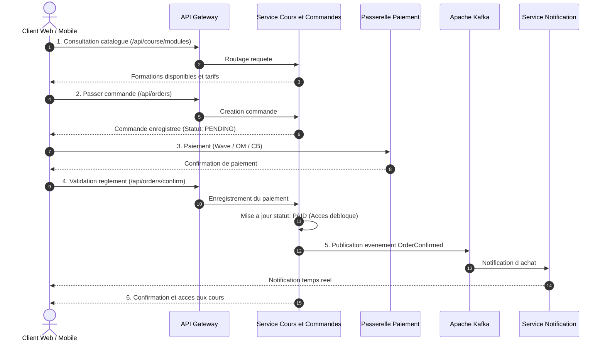

# Diagramme de Séquence : Parcours d'Achat & Inscription

Ce diagramme décrit la cinématique des échanges inter-services lors de la commande d'une formation, du règlement et du déblocage immédiat de l'accès.

## Cinématique des Interactions Inter-Services

## Points Clés du Fonctionnement

1. **Routage et Sécurité Centralisés** : L'API Gateway intercepte les requêtes, valide le jeton JWT et transmet le contexte utilisateur en aval.
2. **Atomicité Locale** : La création de la commande et le déblocage de l'accès s'effectuent au sein de la transaction locale de `course-service`.
3. **Découplage Événementiel** : La diffusion des notifications d'achat s'effectue via Apache Kafka de manière non bloquante.
