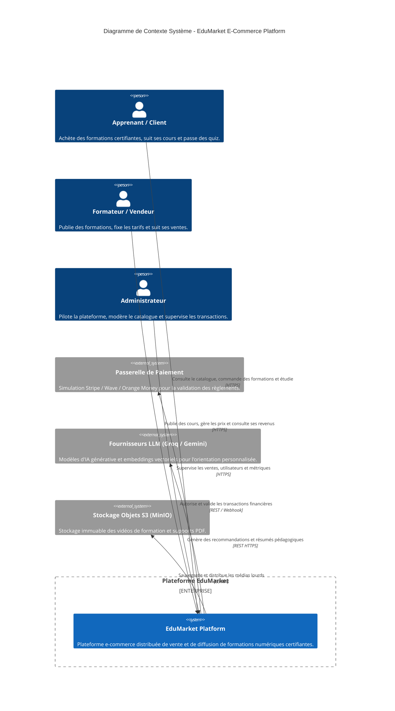

# Dossier d'Architecture & Diagrammes Système (Modèle C4)

Ce dossier documente l'architecture logicielle complète de la plateforme **EduMarket** (E-Commerce de Formations et Certifications Numériques) selon le modèle **C4 (Context, Containers, Components, Code)** complété par les diagrammes de séquence et de déploiement physique.

---

## Sommaire des Diagrammes

1. **[C4 Niveau 1 : Diagramme de Contexte Système](01_c4_system_context.md)**  
   Vision macroscopique montrant les acteurs (Clients, Formateurs, Administrateurs) et les systèmes tiers (Passerelle de paiement, Envoi d'emails, Modèles IA).

2. **[C4 Niveau 2 : Diagramme des Conteneurs](02_c4_container_diagram.md)**  
   Cartographie des applications exécutables, passerelle d'API, serveurs de découverte et de configuration, microservices métiers, bases de données et bus de messages.

3. **[C4 Niveau 3 : Diagramme des Composants](03_c4_component_diagram.md)**  
   Zoom sur l'organisation interne du microservice central `course-service` (Gestion du Catalogue, Pricing et Commandes/Inscriptions).

4. **[Diagramme de Séquence : Parcours d'Achat et Souscription](04_sequence_order_flow.md)**  
   Cinématique complète des interactions inter-services lors de la commande d'une formation, du paiement et de la confirmation asynchrone par Kafka.

5. **[Diagramme de Déploiement : Topologie Docker & Cloud](05_deployment_topology.md)**  
   Organisation des réseaux Docker, volumes persistants, exposition des ports et hébergement cloud.

6. **[Grille d'Audit Architectural & Conformité Séminaire M. MARONE](ARCHITECTURE_AUDIT_MARONE.md)**  
   Évaluation point par point de la conformité du projet selon les 4 modules du séminaire (DDD, Hexagonal, CAP, CI/CD, Observabilité).

---

## Aperçu Visuel Rapide (C4 Niveau 1 - Contexte)

---

*Conforme aux exigences du séminaire d'Architecture Logicielle 2026.*
