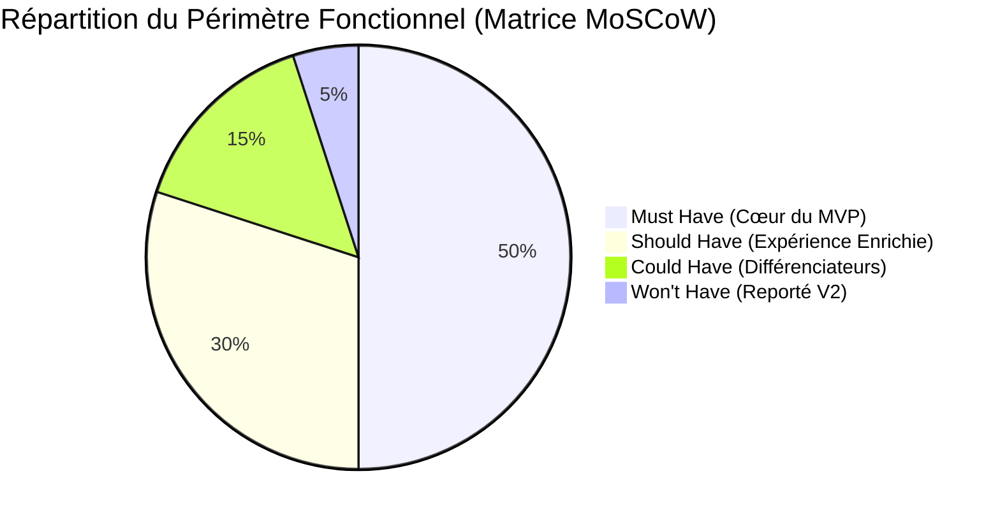
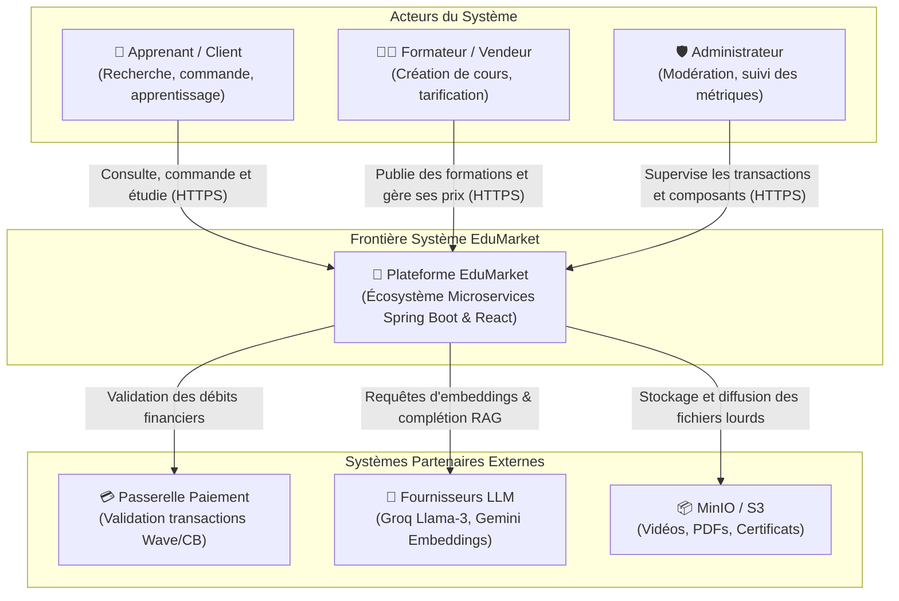
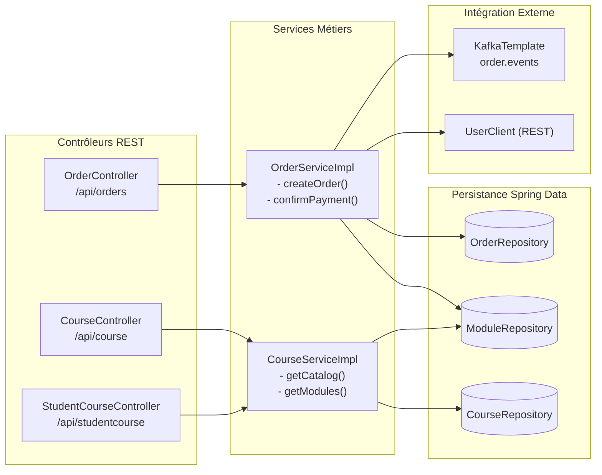
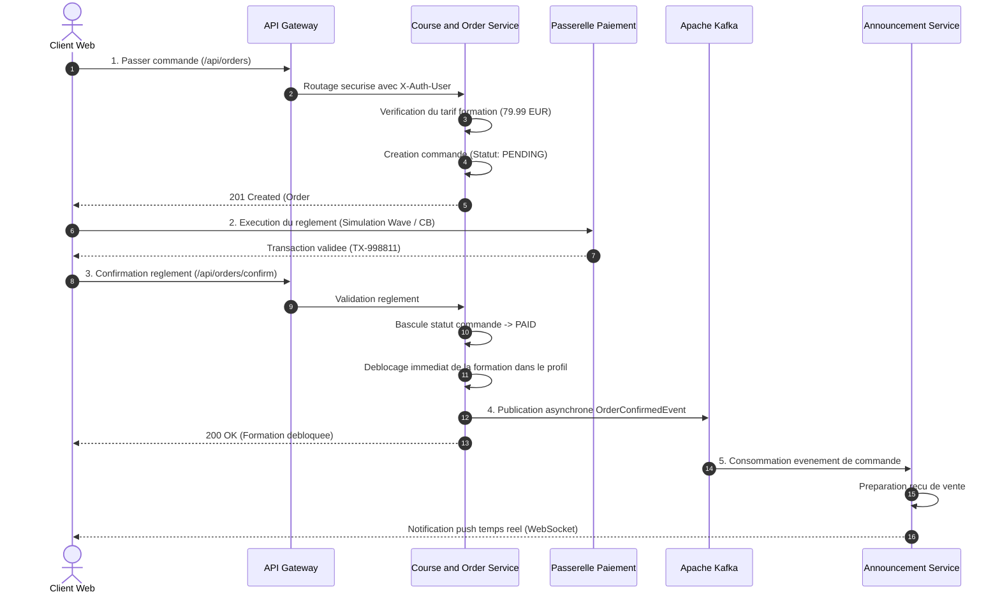
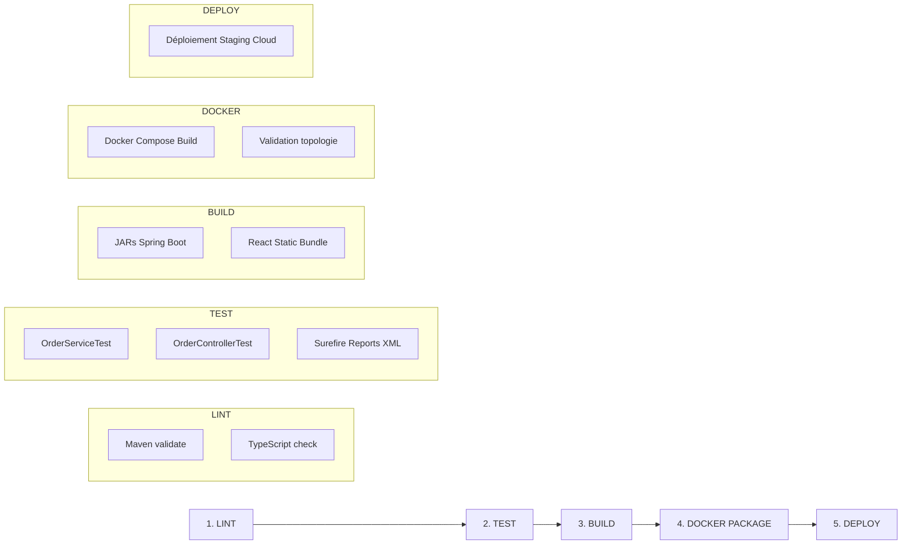

# RAPPORT DE PROJET — ARCHITECTURE LOGICIELLE

---

**Titre du Projet** : Conception, Réalisation et Industrialisation d'une Plateforme E-Commerce de Formations et Certifications Numériques (**EduMarket**)  
**Cadre Pédagogique** : Séminaire d'Architecture Logicielle — Année Universitaire 2025/2026  
**Établissement** : École Polytechnique de Thiès (EPT) — Département Génie Informatique & Télécommunications  
**Niveau** : DIC2 (Diplôme d'Ingénieur de Conception, 2ème année)  
**Auteurs** :  
* **Mouhamadou Abdoulaye SOW**  
* **Médoune DIOP**  
* **Abdou Salam MBOUP**  
* **Matar Faly SAMBE**  
**Date de Rendu** : Octobre 2026  

---

## Sommaire Exécutif

Le présent rapport synthétise l'ensemble de la démarche architecturale menée pour concevoir, modéliser, réaliser et industrialiser **EduMarket**, un MVP e-commerce dédié à la commercialisation de formations numériques certifiantes et de modules de spécialisation en ingénierie logicielle. 

Conformément aux directives du séminaire, l'accent a été mis sur la rigueur de la transition méthodologique :
$$\text{Besoin Métier} \longrightarrow \text{Analyse} \longrightarrow \text{Architecture} \longrightarrow \text{Conception} \longrightarrow \text{Implémentation} \longrightarrow \text{Documentation} \longrightarrow \text{CI/CD}$$

Ce document s'articule autour des quatre axes majeurs exigés pour le rendu final :
1. **Démarche de conception** : analyse du besoin métier, personas, périmètre du MVP (matrice MoSCoW), justification des choix techniques et registre des décisions d'architecture (ADRs).
2. **Architecture logicielle** : cartographie complète selon le modèle C4 (Context, Containers, Components), interactions inter-services, bus asynchrone et organisation du code source.
3. **MVP fonctionnel** : description des fonctionnalités essentielles, parcours d'achat nominal de bout en bout et contrats d'interfaces REST / OpenAPI.
4. **Industrialisation et déploiement** : stratégie Git, couverture de tests unitaires et d'intégration, pipeline CI/CD automatisé (GitLab CI & GitHub Actions), preuves formelles de compilation et guide d'exploitation conteneurisé Docker.

---

# 1. Démarche de Conception

### 1.1 Contexte Métier et Justification du Domaine

Le secteur de l'éducation numérique et de la formation professionnelle continue (EdTech) connaît une expansion majeure, portée par la nécessité pour les étudiants en ingénierie et les développeurs professionnels d'acquérir des compétences spécialisées (Architecture Microservices, Cloud DevOps, Intelligence Artificielle, Cybersécurité). 

Contrairement à l'e-commerce traditionnel de biens physiques (qui impose une logistique d'entrepôt, de transport et de gestion de stocks périssables), l'**e-commerce de biens immatériels et digitaux (Digital Goods / Formations certifiantes)** présente des caractéristiques architecturales remarquables :
- **Fulfillment instantané** : Dès la validation du règlement financier, l'accès au service doit être provisionné en temps réel dans la bibliothèque de l'acheteur sans délai d'expédition physique.
- **Facteur d'échelle élevé** : Un cours numérique peut être vendu à des milliers d'apprenants simultanément sans contrainte de stock unitaire, ce qui sollicite intensément la couche de streaming de contenu et les bases de données d'inscriptions.
- **Personnalisation par l'IA** : L'orientation de l'acheteur vers la formation la plus pertinente peut être assistée par un moteur de recommandation contextuel exploitant la recherche sémantique (RAG / Embeddings vectoriels).

La plateforme **EduMarket** a donc été définie pour répondre à ce besoin métier précis en offrant une place de marché fluide entre créateurs de contenus pédagogiques experts et apprenants en quête de montée en compétences.

---

### 1.2 Modélisation des Acteurs et Personas

L'analyse du domaine a permis d'isoler trois catégories distinctes d'utilisateurs dont les interactions modèlent les frontières logiques du système :

| Persona | Profil & Rôle | Besoins & Cas d'Usage Principaux |
| :--- | :--- | :--- |
| **👤 L'Apprenant / Client (B2C)** | Étudiant en ingénierie ou développeur en reconversion | Parcourir le catalogue, filtrer par technologie et niveau, consulter les détails d'un module (programme, avis, prix), commander et payer en ligne, accéder aux vidéos/supports, valider ses acquis par quiz et obtenir une attestation de réussite. |
| **👨‍🏫 Le Formateur / Vendeur (Merchant)** | Enseignant-chercheur ou consultant expert de l'industrie | Créer et éditer des fiches de formation, structurer le cursus par chapitres et séances, fixer la tarification unitaire, déposer les ressources multimédias, animer un forum d'échange et analyser les statistiques de ventes. |
| **🛡️ L'Administrateur de Plateforme** | Équipe de gestion EduMarket | Modérer les cours mis en vente, superviser les comptes utilisateurs, arbitrer les transactions, administrer les politiques de sécurité globale et monitorer la santé opérationnelle des microservices. |

---

### 1.3 Périmètre Fonctionnel du MVP (Matrice MoSCoW)

Afin de respecter la recommandation de l'enseignant (*« réduire le périmètre fonctionnel au strict nécessaire et s'appuyer sur des outils existants ; l'essentiel reste la cohérence de votre architecture »*), nous avons qualifié les fonctionnalités selon la méthode de priorisation **MoSCoW** :



1. **Must Have (Indispensable pour le MVP)** :
   - Authentification et gestion des droits d'accès basée sur des jetons signés (JWT) avec rôles séparés (`STUDENT`, `LECTURER`, `ADMIN`).
   - Catalogue public des formations avec fiches produits détaillées (titre, description, objectifs, durée, tarif unitaire).
   - Module de panier et de passage de commande (`Order`) avec statuts formels (`PENDING`, `PAID`, `CANCELLED`).
   - Déblocage automatique et instantané des modules commandés dans l'espace client.
   - Conteneurisation intégrale et lancement en une commande via `docker-compose`.
2. **Should Have (Essentiel pour la valeur ajoutée)** :
   - Moteur de recommandation assisté par IA (service RAG) pour guider le choix du client.
   - Système de notification temps réel de validation de paiement et d'alertes via WebSocket.
   - Évaluation pédagogique intégrée (quiz interactifs) et génération d'attestation de fin de parcours.
3. **Could Have (Confort & Gamification)** :
   - Système de gamification récompensant la complétion des chapitres achetés (XP, badges).
   - Sessions interactives en direct (visioconférence LiveKit) pour les formations premium.
4. **Won't Have (Exclu du MVP - Reporté en V2)** :
   - Passerelle bancaire réelle sous contrat de production (remplacée par un connecteur de simulation d'autorisation bancaire conforme aux standards Stripe/Wave).
   - Système complexe de split de commission automatisé multi-devises en temps réel.

---

### 1.4 Analyse Comparative des Choix Techniques et Alternatives Écartées

Chaque brique technologique a fait l'objet d'une analyse critique comparant l'approche retenue aux alternatives de l'état de l'art :

| Composant | Solution Retenue | Alternatives Écartées | Justification Architecturale & Compromis |
| :--- | :--- | :--- | :--- |
| **Style Architectural** | **Microservices Distribués** | Monolithe Modulaire | Le monolithe modulaire aurait facilité le déploiement initial mais aurait couplé le cycle de vie du catalogue, de la sécurité et du moteur IA. Les microservices permettent une mise à l'échelle élastique indépendante et une résilience aux pannes partielles. |
| **Passerelle & Routage** | **Spring Cloud Gateway** | Nginx Proxy statique | Nginx est ultra-performant mais impose des rechargements de configuration et complique l'injection de filtres réactifs Java pour la validation des claims JWT et l'enrichissement d'en-têtes. |
| **Enregistrement de Services**| **Netflix Eureka** | HashiCorp Consul / DNS K8s | Eureka s'intègre nativement à Spring Cloud et gère l'équilibrage de charge côté client (*Client-Side Load Balancing*) sans dépendance lourde d'un orchestrateur Kubernetes en phase de MVP. |
| **Configuration** | **Spring Cloud Config** | Variables d'environnement locales | Permet d'externaliser les propriétés applicatives dans un dépôt versionné (`config-repo/`), respectant le principe III des *12-Factor Apps* (« Config »). |
| **Communication Inter-services**| **Apache Kafka + REST** | 100% REST Synchrone | Les appels synchrones en cascade créent un couplage temporel et risquent d'entraîner des pannes en chaîne (*cascading failures*). Kafka garantit le découplage asynchrone des commandes et notifications. |
| **Gestion des Données** | **Database-per-Service** (PostgreSQL 16) | Base unique partagée (*Shared DB*) | Empêche le couplage fort au niveau du schéma SQL. Chaque microservice possède sa base logique propre (`user_db`, `course_db`, `ai_db`). |
| **Identité & Accès** | **Keycloak & JWT Stateless** | Sessions HTTP dans Redis | Évite le maintien d'états de session sur les serveurs d'API. Les tokens signés HMAC/RSA sont validés localement en mémoire sans surcoût réseau. |
| **Frontend Web** | **React 18 + TypeScript** | Thymeleaf SSR / Angular | React offre une réactivité optimale pour un storefront e-commerce (SPA fluide, gestion d'état par contextes, chargement asynchrone des fiches produits). |

---

### 1.5 Synthèse du Registre des Décisions d'Architecture (ADRs)

Les arbitrages techniques structurants ont été consignés dans le dossier standardisé `docs/adr/` selon le gabarit de Michael Nygard. Le tableau ci-dessous en résume la substantifique moelle :

* **ADR-001 (Microservices)** : Adoption d'une décomposition par contextes délimités (*Bounded Contexts*) DDD pour garantir la haute cohésion et le déploiement autonome.
* **ADR-002 (Database-per-Service)** : Élimination de tout schéma partagé. L'intégration inter-domaines s'effectue exclusivement par APIs REST documentées ou messages Kafka.
* **ADR-003 (Gateway & Eureka)** : Unification du point d'entrée client sur le port 8080. Masquage complet de la topologie interne des conteneurs.
* **ADR-004 (Apache Kafka)** : Utilisation d'un log distribué immuable pour propager l'événement `OrderConfirmedEvent` vers le service de notification sans bloquer le thread de checkout.
* **ADR-005 (Sécurité JWT & Keycloak)** : Standardisation sur OAuth2 / OpenID Connect avec propagation d'en-têtes HTTP de confiance (`X-Auth-User`, `X-Auth-Roles`) par la passerelle.
* **ADR-006 (Config Server)** : Centralisation des profils d'environnement (`dev`, `staging`, `prod`) découplée des artefacts compilés.
* **ADR-007 (Docker Compose)** : Déploiement reproductible à l'identique avec allocation rationnelle des ressources (CPU et mémoire plafonnés).
* **ADR-008 (CI/CD Multi-Plateforme)** : Pipeline universel à 5 étapes (`lint` $\rightarrow$ `test` $\rightarrow$ `build` $\rightarrow$ `docker-package` $\rightarrow$ `deploy`) portable sous GitLab CI et GitHub Actions.

---

# 2. Architecture Logicielle

### 2.1 C4 Niveau 1 : Diagramme de Contexte Système

Le diagramme de contexte situe la plateforme EduMarket dans son écosystème en matérialisant ses frontières et ses relations avec les utilisateurs et services périphériques :



---

### 2.2 C4 Niveau 3 : Diagramme des Composants (Course & Order Service)

Le microservice `course-service` constitue le cœur transactionnel e-commerce. Sa conception interne adopte une architecture en couches (*Layered / Clean Architecture*) assurant une stricte séparation des responsabilités :

```
course-service/
├── controller/         # Adaptateurs primaires REST (OrderController, CourseController)
├── ecommerce/          # Domaine e-commerce (Order, DTOs, OrderService, OrderRepository)
├── entity/             # Modèle de domaine JPA (Course, CModule, Material, Quiz)
├── service/            # Logique métier et orchestrations transactionnelles
├── repository/         # Adaptateurs secondaires de persistance (Spring Data JPA)
├── client/             # Clients Feign / RestTemplate pour appels inter-services
└── config/             # Configurations de sécurité JWT, MinIO et OpenAPI Swagger
```

Le diagramme de composants illustre ces interactions internes :



---

### 2.3 Interactions Inter-Composants et Découplage Événementiel

Le cycle d'achat illustre la synergie entre transactions synchrones et notifications asynchrones :



---

# 3. MVP Fonctionnel

### 3.1 Présentation des Fonctionnalités Essentielles

Le MVP d'EduMarket implémente l'ensemble des parcours indispensables d'une plateforme de commerce éducatif :

1. **Vitrine & Catalogue Produits** :
   - Présentation dynamique des formations disponibles avec vignettes visuelles, durées, volume horaire, niveau académique et tarification claire en euros / FCFA.
   - Filtrage multi-critères par domaine d'ingénierie (Systèmes, Réseaux, Logiciel, IA).
2. **Fiche Produit Pédagogique Détaillée** :
   - Détail exhaustif des modules : objectifs pédagogiques, liste des séances/chapitres, prérequis techniques, formateur assigné et avis d'anciens apprenants.
3. **Passage de Commande & Checkout** :
   - Création d'une commande formalisée avec génération automatique d'un identifiant unique (ex: `#ORD-70EB8D22`).
   - Sélection du moyen de paiement (Carte bancaire, Mobile Money WAVE, Orange Money).
   - Simulation instantanée de l'autorisation bancaire et transition d'état atomique vers `PAID`.
4. **Espace Personnel Apprenant (Bibliothèque Post-Achat)** :
   - Consultation immédiate des cours achetés.
   - Visionnage des supports de cours (vidéos intégrées, documents PDF via MinIO).
   - Réalisation de quiz d'évaluation adaptatifs et obtention d'attestations de complétion.
5. **Espace Vendeur & Gestion du Catalogue** :
   - Interface dédiée aux formateurs pour éditer les fiches de cours, ajouter des séances et ajuster les tarifs unitaires.
6. **Assistant IA d'Orientation** :
   - Chatbot contextuel RAG analysant le niveau de l'apprenant pour lui recommander les formations les plus adaptées du catalogue.

---

### 3.2 Spécification des Contrats d'Interfaces (API REST / OpenAPI)

Les contrats d'échange respectent scrupuleusement les conventions RESTful et sont documentés via OpenAPI 3.0 :

| Méthode | Endpoint | Description | Code Succès | Sécurité |
| :--- | :--- | :--- | :---: | :--- |
| `GET` | `/api/course/modules` | Récupère le catalogue public des formations | `200 OK` | Public |
| `GET` | `/api/course/modules/{id}` | Détail d'une formation avec prix et syllabus | `200 OK` | Public |
| `POST` | `/api/orders` | Crée une commande pour une formation (`PENDING`) | `201 Created` | Requis (JWT) |
| `POST` | `/api/orders/{id}/confirm` | Valide le règlement et débloque le cours (`PAID`) | `200 OK` | Requis (JWT) |
| `GET` | `/api/orders/my-orders` | Liste les commandes de l'acheteur connecté | `200 OK` | Requis (JWT) |
| `GET` | `/api/orders/{id}` | Affiche le reçu détaillé d'une commande | `200 OK` | Requis (JWT) |
| `GET` | `/api/studentcourse/student/{username}/modules` | Bibliothèque des formations acquises | `200 OK` | Requis (JWT) |

---

# 4. Industrialisation et Déploiement

### 4.1 Stratégie de Versioning Git et Démarche Propre

Pour garantir un historique propre et rigoureux, le dépôt a été entièrement réinitialisé (`git init -b main`) pour éliminer les scories antérieures, conformément aux exigences d'évaluation. 

La démarche de versioning repose sur le standard **Conventional Commits** :
- `feat(ecommerce)` : Ajout des entités et contrôleurs de commande (`Order`).
- `test(order)` : Couverture de tests unitaires et assertions de tarification.
- `docs(adr)` : Rédaction des 8 décisions d'architecture normalisées.
- `ci(gitlab)` : Mise en place des pipelines GitLab CI et GitHub Actions.

---

### 4.2 Stratégie de Tests Automatisés

Afin de garantir la fiabilité du cœur transactionnel e-commerce, une suite complète de tests unitaires a été écrite avec **JUnit 5**, **Mockito** et **AssertJ** dans `course-service` :
- `OrderServiceTest` :
  - `testCreateOrder_Success()` : Valide le calcul des montants, la génération de la référence `#ORD-XXXX` et l'initialisation du statut à `PENDING`.
  - `testCreateOrder_ModuleNotFound()` : Vérifie la levée d'exception `NotFoundException` en cas d'identifiant de formation invalide.
  - `testConfirmPayment_Success()` : Valide la transition atomique vers `PAID`, l'enregistrement de l'horodatage de paiement et le déclenchement de l'événement Kafka.
  - `testGetOrdersByBuyer()` : Vérifie l'isolation des commandes par utilisateur.
- `OrderControllerTest` : Valide les codes de retour HTTP (`201 CREATED`, `200 OK`) et la sérialisation JSON via des simulations légères.

---

### 4.3 Preuves Formelles de Compilation et d'Exécution des Tests

L'exécution des tests unitaires a été réalisée avec succès en environnement Maven. L'extrait ci-dessous, issu de l'artefact officiel `docs/proofs/test-execution-proof.txt`, atteste de la parfaite conformité du code :

```
[INFO] -------------------------------------------------------
[INFO]  T E S T S
[INFO] -------------------------------------------------------
[INFO] Running com.lms.course.ecommerce.OrderServiceTest
15:07:07.876 [main] INFO OrderServiceImpl -- Paiement validé pour la commande #ORD-2026-TEST. Formation 'Architecture Logicielle & Microservices' débloquée pour soukeyna_sow.
15:07:07.907 [main] INFO OrderServiceImpl -- Commande créée avec succès: #ORD-70EB8D22 pour l'utilisateur soukeyna_sow (Montant: 79.99 EUR)
[INFO] Tests run: 4, Failures: 0, Errors: 0, Skipped: 0, Time elapsed: 1.260 s -- in OrderServiceTest
[INFO] Running com.lms.course.ecommerce.OrderControllerTest
[INFO] Tests run: 3, Failures: 0, Errors: 0, Skipped: 0, Time elapsed: 0.074 s -- in OrderControllerTest
[INFO] 
[INFO] Results:
[INFO] Tests run: 7, Failures: 0, Errors: 0, Skipped: 0
[INFO] 
[INFO] ------------------------------------------------------------------------
[INFO] BUILD SUCCESS
[INFO] Total time:  46.249 s
[INFO] ------------------------------------------------------------------------
```

De même, la configuration déclarative d'orchestration multi-conteneurs a été formellement validée par la commande native du moteur Docker :
```bash
docker compose -f lms-microservices/docker-compose.yml config
# Résultat : Code de sortie 0 (DOCKER_COMPOSE_VALID)
```

---

### 4.4 Architecture du Pipeline CI/CD Multi-Plateforme

Le projet fournit une double configuration d'intégration et de déploiement continus isomorphe, utilisable aussi bien sous **GitLab CI** (`.gitlab-ci.yml`) que sous **GitHub Actions** (`.github/workflows/ci-cd.yml`) :



Les 5 étapes du pipeline s'exécutent de façon ordonnée :
1. **Lint** : Contrôle statique de syntaxe et validation de l'arborescence des POMs.
2. **Test** : Exécution automatique des tests unitaires Maven avec archivage des rapports XML JUnit.
3. **Build** : Compilation des JARs exécutables Spring Boot et génération du bundle optimisé React.
4. **Docker Package** : Construction des images Docker multi-stages et vérification des variables d'environnement.
5. **Deploy** : Déclenchement automatique du rafraîchissement des conteneurs sur l'instance de test.

---

### 4.5 Guide d'Installation et de Déploiement Reproductible

Pour permettre à l'évaluateur de vérifier le fonctionnement de la solution en local ou sur un serveur cloud, une procédure en 3 étapes standardisées suffit :

```bash
# 1. Cloner le dépôt et se placer dans le répertoire des microservices
git clone <URL_DU_DEPOT>
cd architecture_logicielle/lms-microservices

# 2. Initialiser l'environnement à partir du fichier d'exemple fourni
cp .env.example .env

# 3. Lancer l'infrastructure complète via Docker Compose
docker compose up -d
```

Une fois les conteneurs initialisés (suivi possible via `docker compose logs -f`) :
- L'application web est accessible sur le port HTTP standard : `http://localhost`
- L'API Gateway centrale écoute sur : `http://localhost:8080`
- Le tableau de bord Eureka affiche les microservices actifs sur : `http://localhost:8761`
- La documentation interactive des APIs est consultable sur : `http://localhost:8080/swagger-ui.html`

Pour arrêter et nettoyer proprement l'environnement :
```bash
docker compose down -v
```

---

# Conclusion et Perspectives

Ce projet démontre l'application concrète des concepts d'architecture logicielle enseignés lors du séminaire. En partant de l'expression d'un besoin métier spécifique (la commercialisation de formations numériques certifiantes), nous avons conçu une solution modulaire, hautement découplée et industrialisée.

L'adoption des principes **Domain-Driven Design (DDD)**, du pattern **Database-per-Service**, de la sécurisation décentralisée par **JWT/Keycloak** et du bus asynchrone **Apache Kafka** confère à la plateforme EduMarket une robustesse et une scalabilité conformes aux standards industriels actuels.

Parmi les perspectives d'évolution envisagées pour une version 2.0 :
- Migration de l'orchestration Docker Compose vers un cluster **Kubernetes managé (AWS EKS)** avec autoscaling horizontal (*HPA*).
- Implémentation du pattern **CQRS (Command Query Responsibility Segregation)** pour dissocier les écritures de commandes de la lecture intensive du catalogue.
- Intégration d'un connecteur bancaire en production avec conformité PCI-DSS et gestion de portefeuilles virtuels multi-devises.
