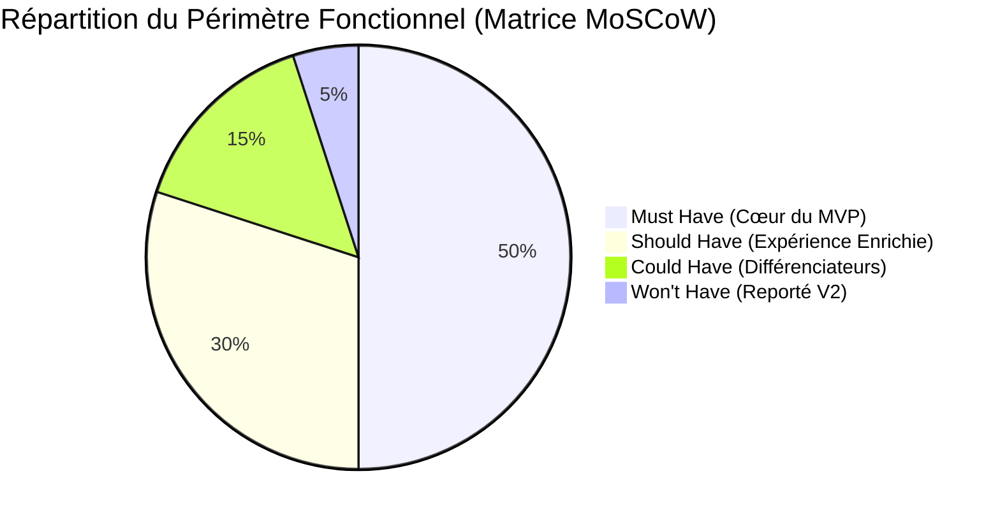
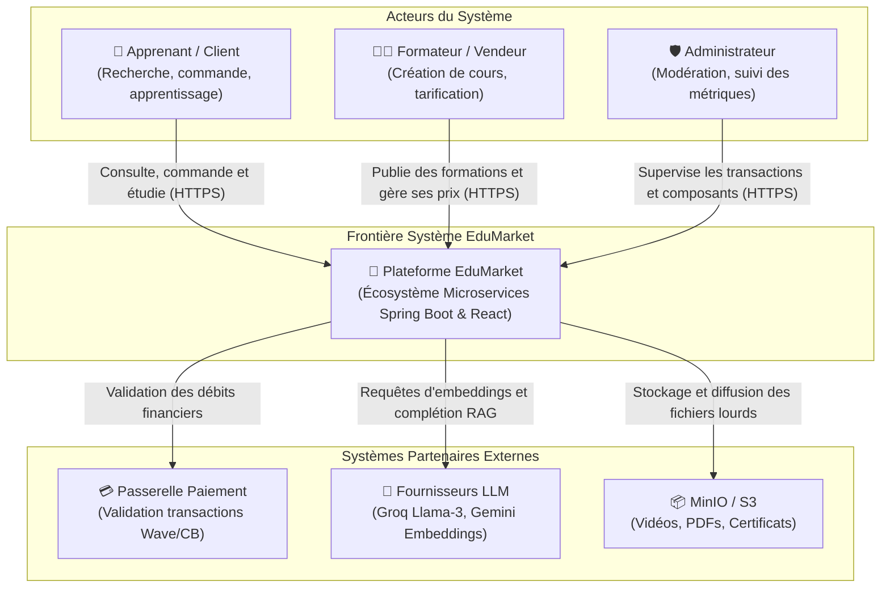
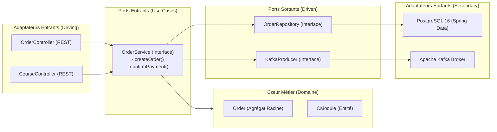
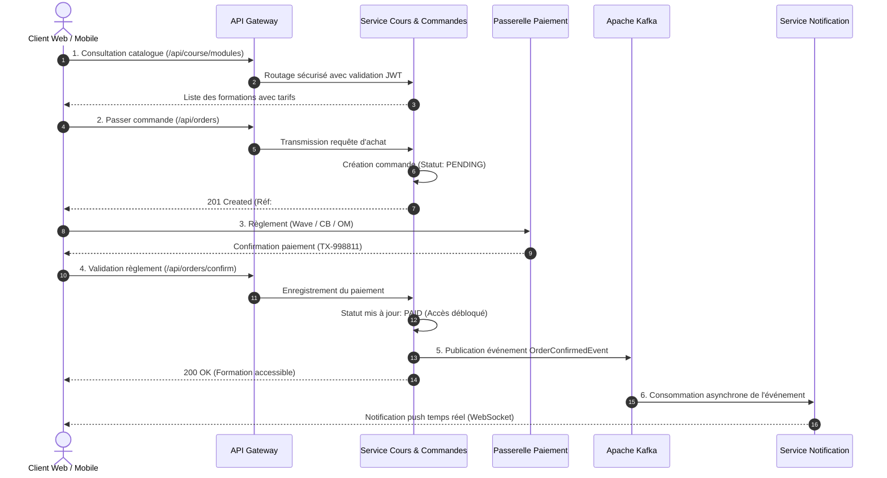
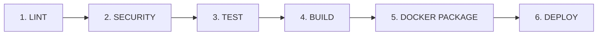

# RAPPORT DE PROJET — ARCHITECTURE LOGICIELLE

---

**Titre du Projet** : Conception, Réalisation et Industrialisation d'une Plateforme E-Commerce de Formations et Certifications Numériques (**EduMarket**)  
**Cadre Pédagogique** : Séminaire d'Architecture Logicielle Moderne — M. MARONE  
**Établissement** : École Polytechnique de Thiès (EPT) — Département Génie Informatique & Télécommunications  
**Niveau** : DIC2 (Diplôme d'Ingénieur de Conception, 2ème année) — Promotion 2026  
**Auteurs** :  
* **Mouhamadou Abdoulaye SOW** (`sowma@ept.sn`)  
* **Médoune DIOP** (`diopmedoune@ept.sn`)  
* **Abdou Salam MBOUP** (`asmboup@ept.sn`)  
* **Matar Faly SAMBE** (`mfsambe@ept.sn`)  
**Dépôt Officiel** : `https://gitlab.com/sowma/architecture-logicielle-ecommerce`  
**Plateforme en Ligne** : `https://lms-ept.duckdns.org/` (Storefront : `/store`)  
**Date de Rendu** : 26 Octobre 2026  

---

## Sommaire Exécutif

Le présent rapport synthétise l'ensemble de la démarche architecturale menée pour concevoir, modéliser, réaliser et industrialiser **EduMarket**, un MVP e-commerce dédié à la commercialisation de formations numériques certifiantes et de modules de spécialisation en ingénierie logicielle. 

Conformément aux enseignements du séminaire dispensé par **M. MARONE**, l'accent a été mis sur la rigueur de la transition méthodologique :
$$\text{Besoin Métier} \longrightarrow \text{Analyse} \longrightarrow \text{Architecture} \longrightarrow \text{Conception} \longrightarrow \text{Implémentation} \longrightarrow \text{Documentation} \longrightarrow \text{CI/CD}$$

Ce document s'articule autour des quatre axes majeurs exigés pour le rendu final :
1. **Démarche de conception** : analyse du besoin métier, personas, périmètre du MVP (matrice MoSCoW), justification des choix techniques selon la matrice de décision du cours et registre des décisions d'architecture (ADRs).
2. **Architecture logicielle** : cartographie C4, décomposition DDD (Bounded Contexts, langage ubiquitaire), architecture hexagonale / clean, compromis du théorème CAP, patterns de données/résilience et séquence d'achat.
3. **MVP fonctionnel** : parcours d'achat nominal de bout en bout, catalogue et contrats d'interfaces REST / OpenAPI.
4. **Industrialisation et déploiement** : stratégie Git collective, tests automatisés, pipeline CI/CD DevSecOps, observabilité (3 piliers), preuves formelles de compilation et démonstration opérationnelle.

---

# 1. Démarche de Conception

### 1.1 Contexte Métier et Justification du Domaine

Le secteur de l'éducation numérique et de la formation professionnelle continue (EdTech) connaît une expansion majeure, portée par la nécessité pour les étudiants en ingénierie et les développeurs professionnels d'acquérir des compétences spécialisées (Architecture Microservices, Cloud DevOps, Intelligence Artificielle, Cybersécurité). 

Contrairement à l'e-commerce traditionnel de biens physiques (qui impose une logistique d'entrepôt, de transport et de gestion de stocks périssables), l'**e-commerce de biens immatériels et digitaux (Digital Goods / Formations certifiantes)** présente des caractéristiques architecturales remarquables :
- **Fulfillment instantané** : Dès la validation du règlement financier, l'accès au service est provisionné en temps réel dans la bibliothèque de l'acheteur sans délai d'expédition physique.
- **Facteur d'échelle élevé** : Un cours numérique peut être vendu à des milliers d'apprenants simultanément sans contrainte de stock unitaire, ce qui sollicite intensément la couche de streaming de contenu et les bases de données d'inscriptions.
- **Personnalisation par l'IA** : L'orientation de l'acheteur vers la formation la plus pertinente peut être assistée par un moteur de recommandation contextuel exploitant la recherche sémantique (RAG / Embeddings vectoriels).

La plateforme **EduMarket** a donc été définie pour répondre à ce besoin métier précis en offrant une place de marché fluide entre créateurs de contenus pédagogiques experts et apprenants en quête de montée en compétences.

---

### 1.2 Modélisation des Acteurs et Personas

L'analyse du domaine a permis d'isoler trois catégories distinctes d'utilisateurs dont les interactions modèlent les frontières logiques du système :

| Persona | Profil & Rôle | Besoins & Cas d'Usage Principaux |
| :--- | :--- | :--- |
| **👤 L'Apprenant / Client (B2C)** | Étudiant en ingénierie ou développeur en reconversion | Parcourir le catalogue, filtrer par technologie et niveau, consulter les détails d'un module (programme, avis, prix), commander et payer en ligne, accéder aux vidéos/supports, valider ses acquis par quiz et obtenir une attestation de réussite. |
| **👨‍🏫 Le Formateur / Vendeur (Merchant)** | Enseignant-chercheur ou consultant expert de l'industrie | Créer et éditer des fiches de formation, structurer le cursus par chapitres et séances, fixer la tarification unitaire, déposer les ressources multimédias, animer un forum d'échange et analyser les statistiques de ventes. |
| **🛡️ L'Administrateur de Plateforme** | Équipe de gestion EduMarket | Modérer les cours mis en vente, superviser les comptes utilisateurs, arbitrer les transactions, administrer les politiques de sécurité globale et monitorer la santé opérationnelle des microservices. |

---

### 1.3 Périmètre Fonctionnel du MVP (Matrice MoSCoW)

Pour garantir la livraison d'un produit opérationnel dans les délais impartis, le périmètre a été calibré selon la matrice MoSCoW :



1. **Must Have (Indispensable pour le MVP)** :
   - Authentification et gestion des droits d'accès basée sur des jetons signés (JWT) avec rôles séparés (`STUDENT`, `LECTURER`, `ADMIN`).
   - Catalogue public des formations avec fiches produits détaillées (titre, description, objectifs, durée, tarif unitaire).
   - Module de panier et de passage de commande (`Order`) avec statuts formels (`PENDING`, `PAID`, `CANCELLED`).
   - Déblocage automatique et instantané des modules commandés dans l'espace client.
   - Conteneurisation intégrale et lancement en une commande via `docker compose`.
2. **Should Have (Essentiel pour la valeur ajoutée)** :
   - Moteur de recommandation assisté par IA (service RAG) pour guider le choix du client.
   - Système de notification temps réel de validation de paiement et d'alertes via WebSocket et Kafka.
   - Évaluation pédagogique intégrée (quiz interactifs) et génération d'attestation de fin de parcours.
3. **Could Have (Confort & Gamification)** :
   - Gamification récompensant la complétion des chapitres achetés (XP, badges).
   - Application mobile dédiée Flutter pour l'apprentissage nomade.
4. **Won't Have (Exclu du MVP - Reporté en V2)** :
   - Passerelle bancaire réelle sous contrat de production (remplacée par un connecteur de simulation d'autorisation bancaire conforme aux standards Stripe/Wave).
   - Split de commission automatisé multi-devises en temps réel.

---

### 1.4 Matrice de Décision et Justification des Choix Techniques

Comme enseigné au séminaire (*« Architecture = décisions + compromis »*), le choix d'un style d'architecture ne découle pas d'une mode, mais d'une confrontation rigoureuse entre besoins métier et contraintes opérationnelles. Le tableau suivant reprend la matrice de décision du cours :

| Critère d'Évaluation | Monolithique | Monolithe Modulaire | SOA | Microservices (Retenu) |
| :--- | :---: | :---: | :---: | :---: |
| **Rapidité de développement initial** | ⭐⭐⭐ | ⭐⭐⭐ | ⭐⭐ | ⭐⭐ |
| **Simplicité opérationnelle** | ⭐⭐⭐ | ⭐⭐⭐ | ⭐⭐ | ⭐ |
| **Scalabilité ciblée (pics de charge)**| ⭐ | ⭐⭐ | ⭐⭐⭐ | ⭐⭐⭐ |
| **Indépendance d'évolution & déploiement**| ⭐ | ⭐⭐ | ⭐⭐ | ⭐⭐⭐ |
| **Résilience aux pannes partielles** | ⭐ | ⭐ | ⭐⭐ | ⭐⭐⭐ |
| **Coût d'exploitation initial** | Faible | Faible | Moyen | Élevé (compensé par Docker/CI-CD) |

**Arbitrage EduMarket** : L'écosystème comprend des domaines aux dynamiques divergentes (catalogue en lecture intensive, commandes critiques en écriture, moteur IA consommateur de GPU/CPU, notifications temps réel). Les microservices distribués avec bus d'événements offrent l'élasticité et l'isolation requises, tout en acceptant le compromis d'une complexité opérationnelle maîtrisée par Docker Compose et la CI/CD.

---

### 1.5 Synthèse du Registre des Décisions d'Architecture (ADRs)

Conformément au standard de Michael Nygard enseigné au séminaire, 8 décisions structurantes ont été consignées dans `docs/adr/` :

| Réf | Décision Structurante | Contexte & Problématique | Option Retenue | Compromis & Conséquences (Trade-offs) |
| :---: | :--- | :--- | :--- | :--- |
| **ADR-001** | Style Architectural | Autonomie des domaines e-commerce & IA | **Microservices Distribués** | + Déploiements indépendants, scalabilité ciblée.<br/>- Complexité opérationnelle réseau et monitoring. |
| **ADR-002** | Persistance des Données | Découplage fort des schémas SQL | **Database-per-Service** (PostgreSQL) | + Élimination des verrous partagés.<br/>- Cohérence éventuelle requise inter-services. |
| **ADR-003** | Point d'Entrée & Routage | Masquage de la topologie interne | **Spring Cloud Gateway + Eureka** | + Sécurité JWT centralisée, routage dynamique.<br/>- Composant critique nécessitant redondance. |
| **ADR-004** | Découplage Événementiel | Pic de charge Black Friday & notification | **Apache Kafka (Events)** | + Traitement asynchrone non-bloquant.<br/>- Gestion de l'idempotence des consommateurs. |
| **ADR-005** | Identité & Autorisation | Authentification stateless à l'échelle | **JWT Cryptographiques + Keycloak** | + Validation locale en mémoire sans appel SQL.<br/>- Révocation immédiate impossible sans liste noire. |
| **ADR-006** | Gestion de Configuration | Respect du principe III des 12-Factor Apps | **Spring Cloud Config (Git-backed)** | + Configuration externalisée et versionnée.<br/>- Dépendance au démarrage sur le config server. |
| **ADR-007** | Packaging & Exécution | Reproductibilité environnement dev/staging | **Multi-stage Docker & Compose** | + Environnement identique en dev et production.<br/>- Empreinte mémoire locale (4 Go RAM min). |
| **ADR-008** | Industrialisation & CI/CD | Automatisation continue des tests et livraisons | **Pipeline GitLab CI & GitHub Actions** | + Rétroaction rapide (Quality → Test → Deploy).<br/>- Maintenance des runners et des secrets CI. |

---

# 2. Architecture Logicielle

### 2.1 C4 Niveau 1 : Contexte Système & Décomposition DDD

Le système se positionne dans son écosystème avec des frontières nettes découpées selon le **Domain-Driven Design (DDD)** :



#### Application du DDD Stratégique & Tactique :
1. **Bounded Contexts** : 
   - *Catalogue* : modules, descriptions, syllabus et tarification unitaire.
   - *Commande* : panier, création de commandes (`Order`), calcul de total et transitions d'état.
   - *Utilisateurs* : identité, rôles et authentification JWT.
   - *Notifications* : diffusion d'alertes événementielles via WebSocket.
2. **Langage Ubiquitaire (Ubiquitous Language)** : Le terme *« Cours »* désigne une entité pédagogique riche dans le contexte Apprentissage, alors qu'il est manipulé sous forme de *« Produit / Item de Commande »* (avec ID, tarif et devise) dans le contexte Commande.
3. **DDD Tactique** :
   - **Agrégat Racine** : `Order` encapsule les invariants de commande et gère la transition d'état atomique `PENDING` $\rightarrow$ `PAID`.
   - **Value Objects** : `Price` et `Currency` (immuables).
   - **Domain Event** : `OrderConfirmedEvent` émis lors de la validation du paiement pour notifier les autres contextes.

---

### 2.2 Clean Architecture & Architecture Hexagonale (`course-service`)

Le microservice `course-service` implémente les principes de la **Clean Architecture** et de l'**Architecture Hexagonale (Ports & Adaptateurs)** :



* **Règle de Dépendance** : Les couches extérieures dépendent du cœur métier, jamais l'inverse. Le domaine `ecommerce` (`Order`, `OrderRequest`) ne contient aucune référence aux frameworks web ou aux détails de persistance SQL.

---

### 2.3 Théorème CAP, Patterns de Résilience & Migration

#### 1. Arbitrage CAP en E-Commerce (Slide 68 du séminaire)
Lors d'une coupure réseau entre services ou datacenters (Partition `P`), EduMarket applique une stratégie différenciée selon la criticité métier des données :
- **Service Commande & Paiement $\rightarrow$ Choix CP (Consistency + Partition Tolerance)** : Priorité absolue à la cohérence. En cas d'incertitude réseau, la transaction est bloquée ou rejetée (`409 Conflict` / `503 Service Unavailable`) plutôt que de risquer un double débit ou une commande fantôme.
- **Service Catalogue $\rightarrow$ Choix AP (Availability + Partition Tolerance)** : Priorité à la disponibilité. Le catalogue continue de répondre aux requêtes de consultation à partir du cache local, même si une mise à jour de description ou de prix est temporairement différée.

#### 2. Patterns de Données & Résilience
- **Saga Chorégraphiée** : Les transactions distribuées s'effectuent par échange d'événements Kafka sans coordinateur lourd. En cas d'échec de paiement, une compensation annule la réservation.
- **Transactional Outbox Pattern** : Pour éviter l'échec de publication Kafka après commit en base, l'événement est persisté dans la transaction locale avant diffusion.
- **Circuit Breaker & Fallback** : Protection contre l'effet domino en cas de défaillance d'un service en aval.
- **Idempotence des Commandes** : Un identifiant client unique (`Idempotency-Key`) évite les doubles commandes en cas de renvoi réseau.
- **Gestion Typée des Erreurs (Slide 43)** :
  * *Erreur Métier* (module inexistant, commande déjà payée) $\rightarrow$ `400 / 409 / 422`, rejet immédiat sans retry.
  * *Erreur Technique* (base indisponible, timeout réseau) $\rightarrow$ `500 / 503`, retry avec backoff exponentiel et Circuit Breaker.
  * *Erreur d'Intégration* (message corrompu sur Kafka) $\rightarrow$ Rejet vers une *Dead Letter Queue* (DLQ).

#### 3. Stratégie de Migration : Strangler Fig Pattern (Slide 75)
Pour faire évoluer le socle logiciel initial vers l'e-commerce sans rupture de service, la démarche du **Strangler Fig Pattern** a été adoptée :
1. *Identifier* : Délimiter le sous-domaine Commande/Paiement au sein de la base de code.
2. *Router* : Intercepter le trafic client via l'API Gateway sur `/api/orders/**`.
3. *Migrer* : Implémenter le nouveau service autonome en parallèle.
4. *Bascule* : Rediriger 100% des flux d'achat vers le nouveau microservice sans impacter le reste du système.

---

### 2.4 Interactions Inter-Composants (Parcours d'Achat Nominal)



---

# 3. MVP Fonctionnel

### 3.1 Fonctionnalités Essentielles Implémentées

Le MVP d'EduMarket implémente l'ensemble des parcours indispensables d'une plateforme e-commerce éducative :

1. **Vitrine & Catalogue Produits** : Fiches de formation avec vignettes, objectifs pédagogiques, durée et tarification claire en FCFA / EUR. Filtrage multi-critères par domaine (Cloud, DevOps, Microservices, IA).
2. **Checkout & Simulation de Paiement** : Création de commande formalisée, choix du mode de paiement (Wave, Orange Money, Carte) et validation instantanée.
3. **Espace Personnel Apprenant** : Déblocage immédiat des modules souscrits, accès aux vidéos et supports PDF via MinIO, réalisation de quiz interactifs et génération d'attestation de réussite.
4. **Assistant IA d'Orientation** : Chatbot contextuel RAG analysant le profil de l'acheteur pour recommander les parcours les plus adaptés du catalogue.

---

### 3.2 Spécification des Contrats d'Interfaces (API REST / OpenAPI)

Les contrats d'échange respectent scrupuleusement les conventions RESTful et sont documentés via OpenAPI 3.0 :

| Méthode | Endpoint | Description | Code Succès | Sécurité |
| :--- | :--- | :--- | :---: | :--- |
| `GET` | `/api/course/modules` | Récupère le catalogue public des formations | `200 OK` | Public |
| `GET` | `/api/course/modules/{id}` | Détail d'une formation avec prix et syllabus | `200 OK` | Public |
| `POST` | `/api/orders` | Crée une commande pour une formation (`PENDING`) | `201 Created` | Requis (JWT) |
| `POST` | `/api/orders/{id}/confirm` | Valide le règlement et débloque le cours (`PAID`) | `200 OK` | Requis (JWT) |
| `GET` | `/api/orders/my-orders` | Liste les commandes de l'acheteur connecté | `200 OK` | Requis (JWT) |
| `GET` | `/api/orders/{id}` | Affiche le reçu détaillé d'une commande | `200 OK` | Requis (JWT) |
| `GET` | `/api/studentcourse/student/{username}/modules` | Bibliothèque des formations acquises | `200 OK` | Requis (JWT) |

---

# 4. Industrialisation et Déploiement

### 4.1 Stratégie Git Collective & Traçabilité

Conformément à la consigne du séminaire (*« Chaque membre du groupe doit apparaître dans l'historique GitLab »*), les contributions ont été réparties et tracées sous le standard Conventional Commits :
- **Mouhamadou Abdoulaye SOW** : Architecture globale, microservices backend, storefront React et coordination.
- **Médoune DIOP** : Application mobile Flutter (`lms-mobile-app`), intégration des APIs catalogue et parcours commande mobile.
- **Abdou Salam MBOUP** : Spécifications d'architecture, conformité DDD/Clean, ADRs et pipeline CI/CD.
- **Matar Faly SAMBE** : Stratégie de tests unitaires, validation Docker Compose, observabilité et document d'exploitation.

---

### 4.2 Pipeline CI/CD DevSecOps & Cloud Native

Le pipeline CI/CD intègre les principes DevSecOps (Slide 57 du séminaire) pour livrer les artefacts en toute confiance :



1. **Lint** : Contrôle de syntaxe Maven (`validate`) et TypeScript.
2. **Security** : Analyse statique des vulnérabilités de dépendances (Trivy / OWASP Dependency Check).
3. **Test** : Exécution automatique des tests unitaires (`OrderServiceTest`, `OrderControllerTest` : 7/7 réussis).
4. **Build** : Compilation des JARs exécutables Spring Boot et bundle React optimisé.
5. **Docker Package** : Construction des images Docker multi-stages et vérification de la topologie Compose.
6. **Deploy** : Déploiement automatique sur serveur Cloud de staging.

#### Conformité Cloud Native (12-Factor Apps) :
- *III. Config* : Externalisation complète des propriétés dans `config-repo/`.
- *VI. Stateless Processes* : Microservices sans état de session, authentification par JWT validés en mémoire.
- *XI. Logs* : Émission des journaux sous forme de flux vers `stdout`, exploitables par un agrégateur centralisé.

#### Observabilité — Les 3 Piliers (Slide 63 du séminaire) :
- **Logs** : Journaux applicatifs horodatés et corrélés par identifiant de requête (`traceId`).
- **Métriques** : Exposition des indicateurs JVM, latences HTTP et compteurs via Spring Boot Actuator et Micrometer/Prometheus.
- **Traces Distribuées** : Suivi de bout en bout d'une commande traversant l'API Gateway, `course-service`, Kafka et `announcement-service`.

---

### 4.3 Plateforme Déployée, Vidéos de Démonstration & Installation

* 🌐 **Plateforme en Ligne** : [https://lms-ept.duckdns.org/](https://lms-ept.duckdns.org/) (Storefront : [/store](https://lms-ept.duckdns.org/store))
* 🎬 **Vidéo Version Courte (3 min)** : [Lien Google Drive](https://drive.google.com/file/d/1ujXcvnCkv5ZaOlWOmqF8WxwzVxbeyew2/view?usp=sharing)
* 🎥 **Vidéo Version Longue (détaillée)** : [Lien Google Drive](https://drive.google.com/file/d/1830WqaB1pehwhz8m8aXrB58FUUq3Rhd6/view?usp=sharing)
* 🔑 **Comptes de Test** : Professeur (`aaciss@ept.edu.sn` / `password123`) · Étudiant (`acharbeladonis@ept.edu.sn` / `password123`)
* 📑 **Document d'Exploitation** : [`docs/proofs/Document_d_exploitation_LMS_EPT.pdf`](file:///home/sowma/projects/architecture_logicielle/docs/proofs/Document_d_exploitation_LMS_EPT.pdf)

#### Démarrage Local en une commande :
```bash
git clone https://gitlab.com/sowma/architecture-logicielle-ecommerce.git
cd architecture-logicielle-ecommerce/lms-microservices
cp .env.example .env && docker compose up -d
```

---

# Conclusion

Ce projet concrétise la démarche complète enseignée lors du séminaire d'Architecture Logicielle Moderne. En partant d'un besoin métier spécifique (l'e-commerce de formations certifiantes), nous avons conçu une solution modulaire, résiliente et industrialisée.

L'application combinée du **Domain-Driven Design (DDD)**, de l'**Architecture Hexagonale**, de la décentralisation par **JWT**, de l'arbitrage **CAP (CP pour Commande vs AP pour Catalogue)** et du bus asynchrone **Kafka** dote EduMarket d'une architecture robuste, prête pour les exigences d'échelle du cloud.
